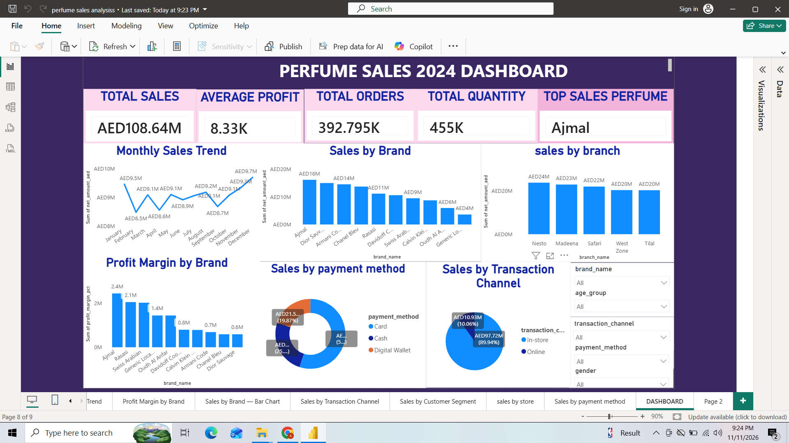

# Perfume-Sales-Analysis
Power BI dashboard for perfume sales analysis, revenue insights, and business performance.
# Perfume Sales Analysis – Power BI Dashboard

## Project Overview
This project focuses on analyzing perfume sales data using Microsoft Power BI. The dashboard provides insights into sales performance, revenue trends, and business performance to support data-driven decision-making.

## Tools Used
- Microsoft Power BI
- Microsoft Excel
- Data Visualization
- Data Analysis

## Dataset
The dataset contains perfume sales information used for analyzing business performance.

[View Dataset – Google Sheets](https://docs.google.com/spreadsheets/d/1Z6GdtC14zWHm4kyG-ZIzgVhcXRaR1poz/edit?usp=sharing)

## Dashboard Preview

## Key Analysis
- Sales performance analysis
- Revenue analysis
- KPI monitoring
- Interactive dashboard visualization

## Project Files
- `Perfume_Sales_Dashboard.pbix` – Power BI dashboard file
- `perfume_dashboard.png` – Dashboard screenshot
- Dataset – Google Sheets link

## Conclusion
This project demonstrates the use of Power BI to transform raw sales data into meaningful business insights through interactive visualizations and KPI tracking.
